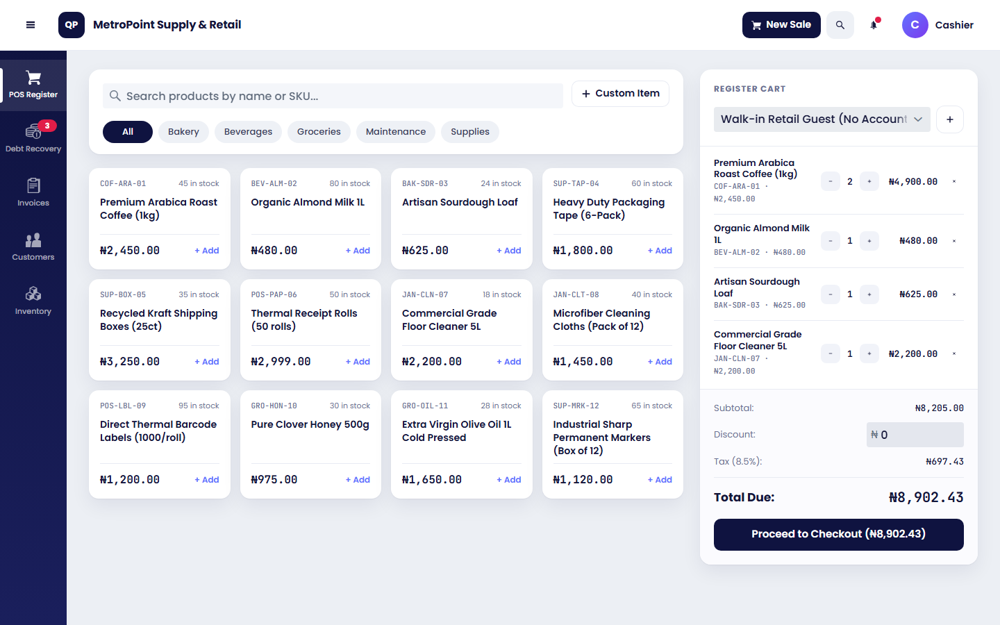
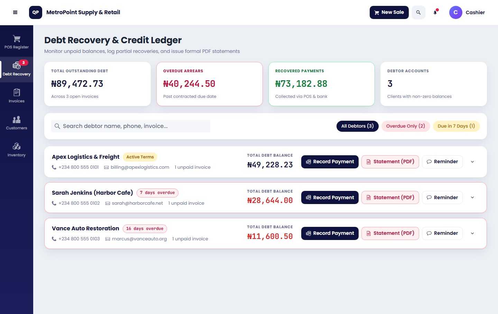
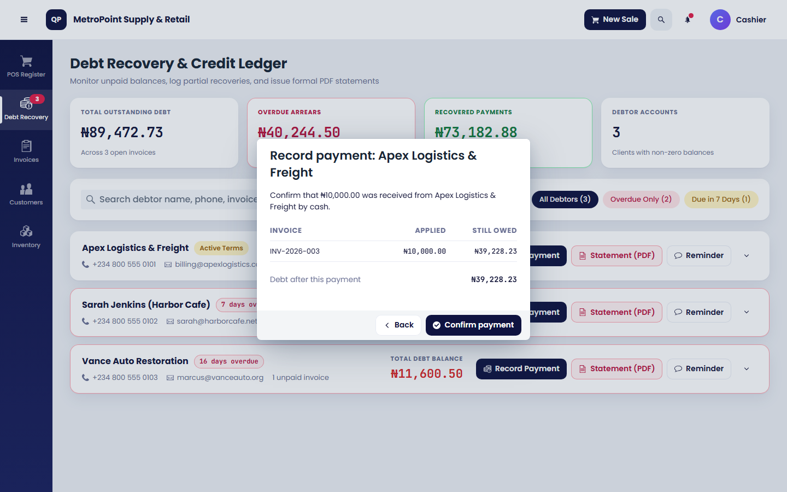
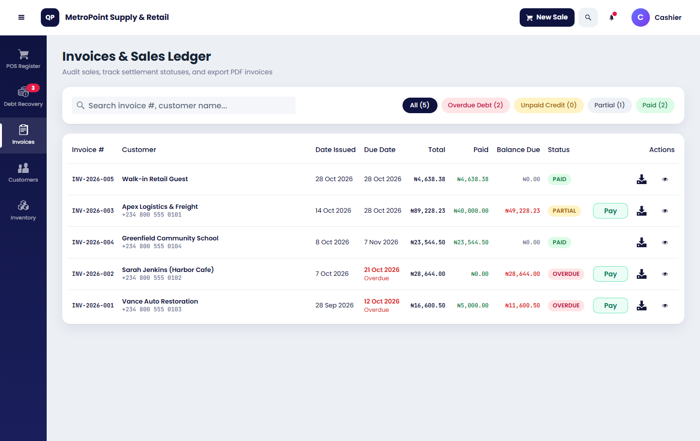
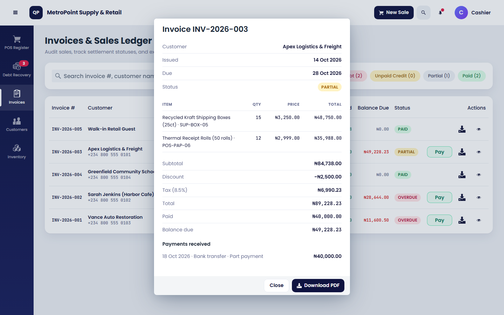
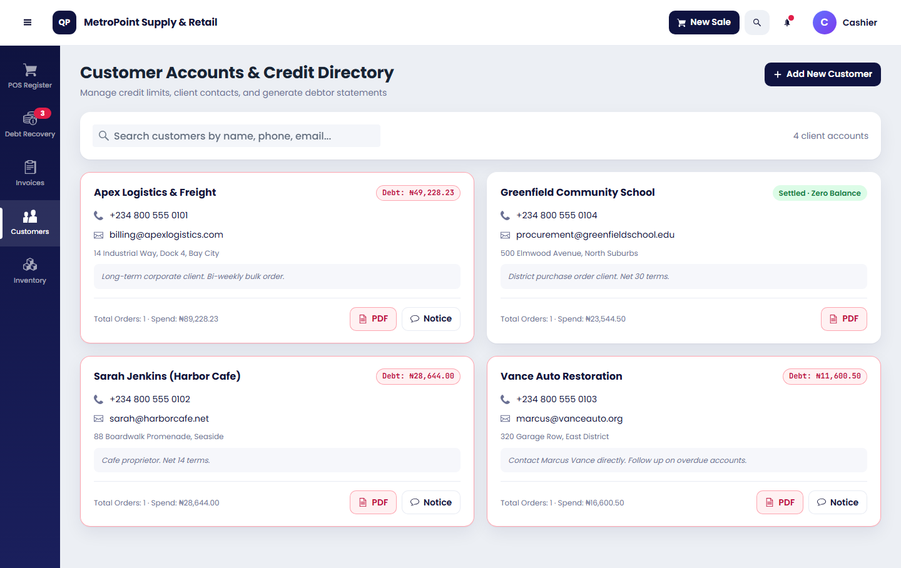
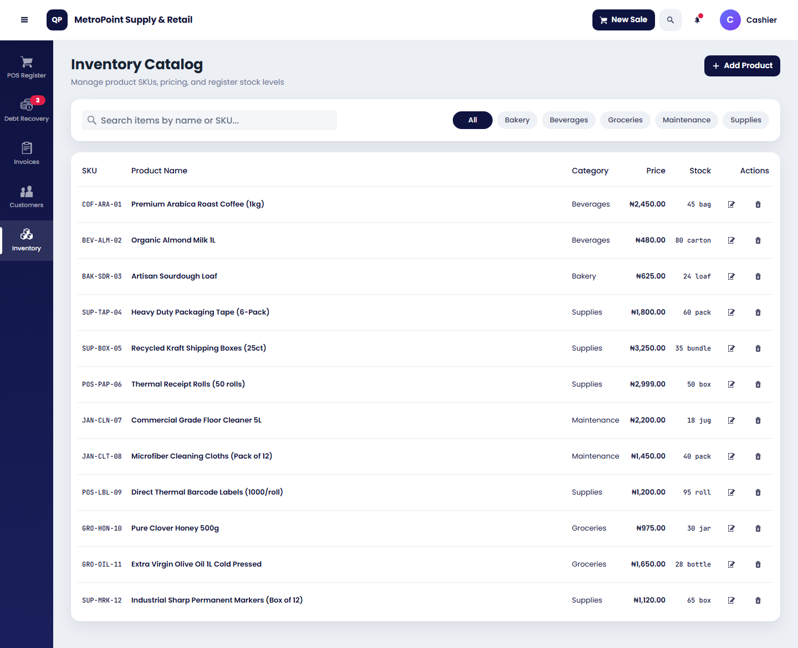

# Inventory POS (Groups 6 and 7)

A standalone Vaadin Flow app with five screens: **POS Register**, **Debt Recovery**, **Invoices**, **Customers** and
**Inventory**. It has its own database and shares no code with the reporting projects. The sidebar and header follow the
Figma frame (narrow dark sidebar, icon over label, white header bar).

| Part | Standard |
|---|---|
| Java | 25 LTS |
| Spring Boot | 4.1.2 |
| Vaadin Flow | 25.3.3 |
| Build | Maven 3.9.11 through the wrapper (`mvnw`), nothing to install |
| Database | H2 in memory for development, MySQL 8.4 through the `mysql` profile |
| PDFs | OpenPDF 3.0.5 |

## Screenshots

**POS Register.** Search and filter products, build the cart, pick a customer or walk-in, and check out.



**Debt Recovery.** Who owes what, with Record Payment, Statement (PDF) and Reminder.



**Debt payment review.** Step two of recording a debt payment: review exactly which invoices the payment clears before confirming.



**Invoices.** Every sale with its status (Paid, Partial, Unpaid, Overdue), searchable and filterable.



**Invoice detail.** The full invoice with its lines and payments, opened from the Invoices screen.



**Customers.** Account cards with contact details, spend and what each customer owes.



**Inventory.** Add, edit and delete products with SKU, category, price, stock and unit.



## Run it

```
./mvnw spring-boot:run
```

Open http://localhost:8082. The first start takes a minute or two because Vaadin builds its front end. The default `dev`
profile fills H2 with a small shop (12 products, 4 customers, 5 invoices, some overdue), rebuilt on every start.
Run the tests with `./mvnw test`. On Windows PowerShell or cmd use `mvnw.cmd`.

### MySQL

Set `DB_USERNAME` and `DB_PASSWORD` in your environment, then start with `--spring.profiles.active=mysql`.

### Settings (`src/main/resources/application.properties`)

| Setting | Default |
|---|---|
| `pos.business-name` | MetroPoint Supply & Retail (printed on PDFs and shown in the header) |
| `pos.tax-rate` | 0.085 (8.5%, the rate in the design; change it to your local rate) |
| `server.port` | 8082 |

## What each screen does

- **POS Register**: search and filter the catalogue, click a product to add it, change quantities, add a custom item
  (such as a delivery fee), apply a discount, choose a customer or "Walk-in", then check out. Stock is taken off the
  shelf at checkout. A walk-in must pay in full. A customer can pay part now; the rest becomes a debt that falls due after
  their payment terms (14 days by default).
- **Invoices**: every sale with its status (Paid, Partial, Unpaid, Overdue), searchable and filterable. **Pay** records a
  payment against one invoice, the eye icon opens the full invoice, and the download icon gives a PDF.
- **Debt Recovery**: who owes what. **Record Payment** is two steps on purpose: enter the amount, then review exactly
  which invoices it clears and confirm. Nothing is saved until the second step. The payment clears the oldest invoice
  first. **Statement (PDF)** prints a statement of account. **Reminder** writes the wording and logs it.
- **Customers**: account cards with contact details, spend and what they owe. Add a customer here or from the register.
- **Inventory**: add, edit and delete products with SKU, category, price, stock and unit.

## Rules the code enforces (all covered by tests)

- Stock cannot go below zero: a sale for more than is in stock is refused.
- A walk-in sale cannot owe money. Discounts cannot exceed the subtotal.
- A payment must be above zero and cannot exceed what is owed.
- Invoice lines keep the product name, SKU and price as sold, so editing or deleting a product never changes an old invoice.
- An invoice past its due date is Overdue even if it is partly paid.

## The team

Who worked on what. Package IDs are explained in [docs/WORK-PACKAGES.md](docs/WORK-PACKAGES.md), which also lists the owner of every package and the files they own.

| # | Name | Matric no. | Group | Role | Work packages |
|---|---|---|---|---|---|
| 1 | ODDE OPEYEMI SAMUEL | F/ND/25/3210122 | Group 7 | Group leader | CORE-1, CORE-2, CORE-3, DEBT-2, QA-1 |
| 2 | Israel Usman | F/ND/25/3210261 | Group 6 | Group leader | SHELL-1, SHELL-2, REG-1, QA-2 |
| 3 | Salami Benjamin Boluwatife | F/ND/25/3210285 | Group 6 | Member | REG-2, REG-3 |
| 4 | Abibat Foladara Omosanya | F/ND/25/3210213 | Group 6 | Member | REG-4 |
| 5 | Saadu Quadri Bolaji | F/ND/25/3210151 | Group 6 | Member | REG-5 |
| 6 | Uche Gift Ebube | F/ND/25/3210114 | Group 6 | Member | REG-6, REG-7 |
| 7 | Olowe Samuel Olatunde | F/ND/25/3210174 | Group 6 | Member | INV-1 |
| 8 | Williams Fadejimi Eniola | F/ND/25/3210016 | Group 6 | Member | INV-2, INV-3 |
| 9 | Isaac Daniel Ukwuoma | F/ND/25/3210281 | Group 6 | Member | INV-4 |
| 10 | Adeniyi Omoseeke Inioluwa | F/ND/25/3210001 | Group 6 | Member | INV-5 |
| 11 | Lawal AbdulBasit Ayinde | F/ND/25/3210206 | Group 6 | Member | INV-6 |
| 12 | Yusuf Anifat Titilope | F/ND/25/3210110 | Group 6 | Member | CUS-1 |
| 13 | Afolabi Ayomide Praise | F/ND/25/3210166 | Group 6 | Member | CUS-2, CUS-3 |
| 14 | Adebayo Adebimpe Latifat | F/ND/25/3210362 | Group 6 | Member | CUS-4 |
| 15 | Ikonagbon Faith Osose | F/ND/25/3210005 | Group 6 | Member | CRET-1 |
| 16 | Adeyemi Blessing Adedamola | F/ND/25/3210080 | Group 6 | Member | CRET-2 |
| 17 | Muhammad Adeyemi Olamilekan | F/ND/25/3210414 | Group 6 | Member | REP-1 |
| 18 | Obioma Ugochukwu Emmanuel | F/ND/25/3210351 | Group 6 | Member | REP-2 |
| 19 | Ogunware Abdulwasiu Olamide | F/ND/25/3210320 | Group 6 | Member | LOY-1 |
| 20 | Kpokonu David Odunayo | F/ND/25/3210048 | Group 6 | Member | SHELL-3, SHELL-4 |
| 21 | Olaoluwa Enoch Toluwalase | F/ND/25/3210154 | Group 7 | Member | DEBT-1 |
| 22 | Churchill Samuel Kelechi | F/ND/25/3210263 | Group 7 | Member | DEBT-3 |
| 23 | Yekini Abdulrahmon Akorede | F/ND/25/3210076 | Group 7 | Member | DEBT-4 |
| 24 | Idama Daniel Oghenekparoboh | F/ND/25/3210317 | Group 7 | Member | DEBT-5 |
| 25 | Akukwe Virginia Chizoba | F/ND/25/3210284 | Group 7 | Member | DEBT-6 |
| 26 | Oyebode Abdulganiu Adebola | F/ND/25/3210194 | Group 7 | Member | DEBT-7 |
| 27 | Oladele David Oluwaseun | F/ND/25/3210356 | Group 7 | Member | STK-1, CORE-4 |
| 28 | Amaize Abraham Maxwell | F/ND/25/3210232 | Group 7 | Member | STK-2 |
| 29 | Odeyemi Joseph Ayomide | F/ND/25/3210205 | Group 7 | Member | STK-3 |
| 30 | Salaudeen Abdul Malik Adeniyi | F/ND/25/3210332 | Group 7 | Member | STK-4 |
| 31 | Oyewo Omotolani Emmanuel | F/ND/25/3210191 | Group 7 | Member | VEN-1 |
| 32 | Alaran Aishat Ololade | F/ND/25/3210293 | Group 7 | Member | VEN-2 |
| 33 | George Godglory Praise | F/ND/25/3210058 | Group 7 | Member | VEN-3 |
| 34 | Abdulsalam Mazeed Adedeji | F/ND/25/3210190 | Group 7 | Member | COM-1, CON-1 |
| 35 | Mathew Martha Theresa | F/ND/25/3210161 | Group 7 | Member | PO-1 |
| 36 | Balogun Sekinat | F/ND/25/3210095 | Group 7 | Member | PO-2 |
| 37 | Abdulrasheed Abdulquadri Temilade | F/ND/25/3210308 | Group 7 | Member | PAY-1 |
| 38 | Adeshina Quadri Ayomide | F/ND/25/3210138 | Group 7 | Member | VRET-1 |
| 39 | Mohammed Ahmed Ayomide | F/ND/25/3210255 | Group 6 | Member | testing |
| 40 | Sunwenghan Emmanuel | F/ND/25/3210108 | Group 6 | Member | testing |
| 41 | Ogundare Omoyemi Victoria | F/ND/25/3210233 | Group 6 | Member | testing |
| 42 | Olabiyi Emmanuel Ayooluwa | F/ND/25/3210132 | Group 6 | Member | testing |
| 43 | Awoniyi Nasrulahi | F/ND/25/3210240 | Group 7 | Member | testing |
| 44 | Akinyemi Oluwafemipaul | F/ND/25/3210111 | Group 7 | Member | testing |
| 45 | Oluwasegun Emmanuel Toluwani | F/ND/25/321301 | Group 7 | Member | testing |


